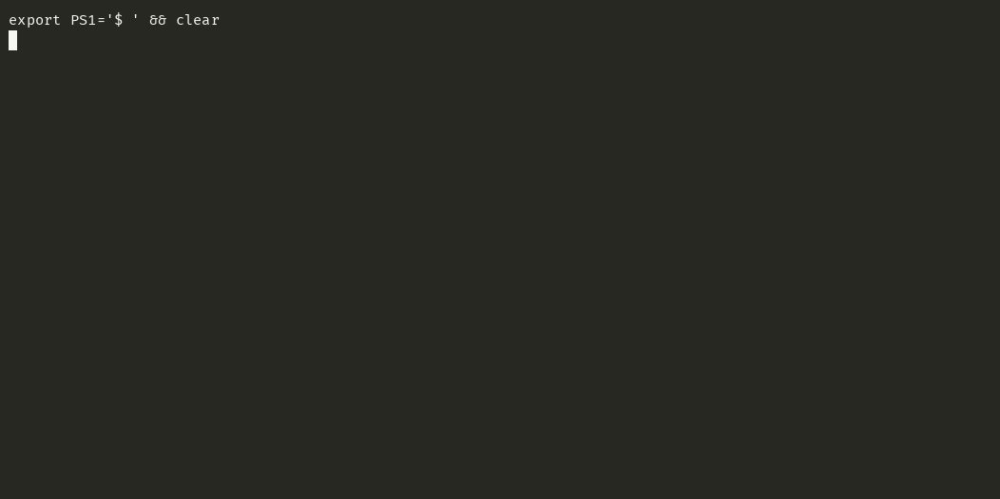

# rigger

Set up a Mac or a Debian/Ubuntu machine from your own git repo, choose what each machine gets,
and keep all of them in sync. Mac-only, Linux-only and mixed setups all work.



**Status:** 0.x. Used daily on the author's Macs and Linux server; the manifest format may still
change before 1.0.

## Why rigger

Your setup repo stays plain: Brewfiles, dotfiles and scripts, plus one `manifest.yaml` that
groups them into components and profiles. rigger adds what those files cannot do alone:

- **Pick per machine.** A profile (laptop, work, server) is the starting point; untick any
  component or single Brewfile package. The choice is saved as a small diff in
  `hosts/<machine>.yaml`, so later profile changes still reach every machine.
- **Links, not copies.** Configs are symlinked into the repo, so an edit on any machine is a
  git change (a tool that rewrites its own config gets a seeded copy instead). `rigger sync`
  commits it, pulls the other machines' changes and re-applies them.
- **Safe on a machine you already use.** It shows the plan first, backs up what it replaces,
  and never uninstalls or deletes anything.
- **Secrets stay out of git.** Templates take `${TOKEN}` from a local secrets file, and sync
  refuses to commit anything that looks like a credential.

Already have a dotfiles repo? Add a `manifest.yaml` to it; the files stay where they are.
Compared with dotbot, rigger adds per-machine picks, package installs and two-way sync.

## What a setup repo looks like

```
manifest.yaml
brew/core.Brewfile        # brew "ripgrep", cask "font-fira-code", …
zsh/.zshrc
hosts/                    # written by rigger, one file per machine
```

```yaml
version: 1
profiles:
  laptop: {components: [core-cli, zsh]}
  server: {components: [linux-core, zsh]}
components:
  - id: core-cli
    group: packages
    platforms: [darwin]
    brewfile: brew/core.Brewfile
  - id: linux-core
    group: packages
    platforms: [linux]
    apt: [git, zsh, ripgrep]
  - id: zsh
    group: shell
    links:
      - {src: zsh/.zshrc, dst: ~/.zshrc}
```

[`example/`](example) is a complete starting point; [docs/setup-repo.md](docs/setup-repo.md) is
the full reference (seeds, scripts, requirements, validation).

## Install

Needs git. macOS (arm64, amd64) or Debian/Ubuntu (arm64, amd64). Homebrew is not needed up front:
a component can install it, as `example/` does.

```bash
brew install --cask k0nsta/apps/rigger
# or, without Homebrew: installs to ~/.local/bin (put it on PATH)
curl -fsSL https://github.com/k0nsta/rigger/releases/latest/download/install.sh | sh
```

The binaries are not signed. The cask and `install.sh` handle that; a binary downloaded in a
browser needs `xattr -d com.apple.quarantine rigger`.

## Quickstart

```bash
# 1. your own (private) repo, started from the example
git clone --depth 1 https://github.com/k0nsta/rigger /tmp/rigger
cp -R /tmp/rigger/example ~/machine-setup && cd ~/machine-setup
#    edit manifest.yaml and brew/core.Brewfile, then check them
rigger validate .
git init -b main && git add . && git commit -m "my setup"
git remote add origin git@github.com:you/machine-setup && git push -u origin main

# 2. on each machine
rigger init git@github.com:you/machine-setup     # clones to ~/github.com/machine-setup, opens the TUI
```

The TUI asks for a machine name and a profile, lets you toggle components (`enter` on a
Brewfile opens its packages), shows the plan, asks for missing secrets and runs.

A new machine without SSH keys can use the HTTPS URL: rigger asks for a token once and never
stores it.

## Every day

```bash
rigger                 # TUI for the remembered repo
rigger status          # what is in place; exit 1 if anything is missing
rigger apply --yes     # non-interactive, from hosts/<machine>.yaml
rigger sync            # commit your changes, pull other machines', re-apply, push
rigger adopt <path>    # take a live edit back into the repo
rigger remote myvps    # install rigger on an ssh host, clone the repo there, run the TUI
rigger validate .      # check a setup repo (use it in the repo's CI)
rigger skill install   # teach Claude Code and Codex how to change your setup repo
```

| Flag | Does |
|---|---|
| `--repo DIR` | use this setup repo (or `$RIGGER_REPO`) instead of the remembered one |
| `--host NAME` | act as this machine |
| `--profile P` | start from profile P |
| `--only a,b` | apply just these components this once; the saved picks stay as they are |
| `--dry-run` | show the plan, change nothing |

## Common tasks

| I want to… | Do this |
|---|---|
| share an app I installed by hand | `rigger sync`; it lists the app and asks which Brewfile it goes to, or to ignore it here |
| remove an app from this machine | `rigger`, untick it, `c`, `enter`, then `rigger sync`; uninstall it yourself (rigger never does). Removing it by hand alone does not stick: sync offers it again |
| stop getting something another machine added | in `rigger sync`, type `-N` for that component |
| track a new config file | copy it into the repo, add a `links` entry to `manifest.yaml`, `rigger apply` |
| fix a config that stopped syncing | an editor or `sed -i` replaced the link with a file: `rigger adopt <path>` |
| sort out a sync conflict | rigger aborts the pull and prints the git commands to resolve it; then `rigger sync` again |
| move the setup repo | when the old checkout is gone, run rigger once from the new directory; it relinks without backups |
| stop using rigger | replace each link with a copy of its file: `cp -L ~/.zshrc ~/.zshrc.tmp && mv ~/.zshrc.tmp ~/.zshrc` |

Anything rigger replaces is backed up to `~/.local/state/rigger/backups/<time>/`; run logs are
in `~/.local/state/rigger/logs/`.

## Contributing

Issues and pull requests are welcome; see [CONTRIBUTING.md](CONTRIBUTING.md).

## License

MIT
